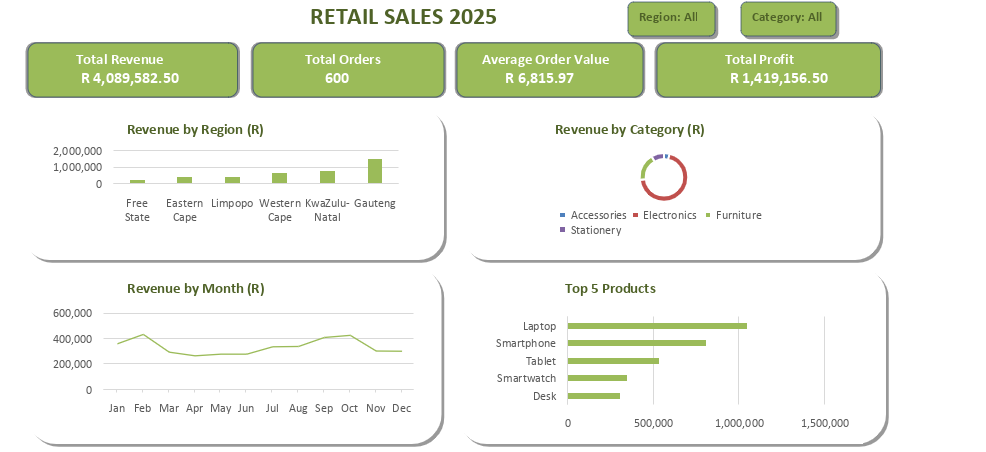

# Retail-Sales-Dashboard-2025
Retail Sales Dashboard 2025 built in ONLYOFFICE
## About the project 
This is my first data analytics project. I created a Retail Sales Dashboard using ONLYOFFICE to represent Sales data in a simple and visual way.

> Note: This project uses sample data for learning and practice purpose. The figures do not represent actual business sales.

## Dashboard Preview
                

## Dashboard_Features
- **Total Revenue:** Shows the total money made from sales(R4,089,582).
- **Total Orders:** Shows the number of orders received.
- **Average Order Value:** Shows the average amount spent per order.
- **Total Profit:** Shows the total profit made.
- **Revenue by Region:** Compares sales across different regions.
- **Revenue by Category:** Compares sales across different regions.
- **Revenue by Month:** Displays monthly sales performance.
- **Top 5 Products:** Shows the five products with the highest sales.

## Tools used
- ONLYOFFICE Spreadsheet 
- Pivot tables
- Charts and graphs
- Sale Data Analysis
- Data Visualisation
- Dashboard Design

## Key Insights
- Total Revenue: R4,089,582
- Electronics is the top category
- Lap top is the top selling product
- February was the best month for sales
- Gauteng is the strongest region

## What i Learned
- Using Pivot Tables to summarise sales data.
- Creating charts and graphs to present information.
- Comparing sales across regions, categories, and monhts.
- Designing a deshboard to make data easier to understand.

## Purpose
I created this project to practice my data analytics skills and build my portfolio as an aspiring Data Analyst.

## Author
M.Z Pitso | Computer Science Graduate | Aspiring Data Analyst
